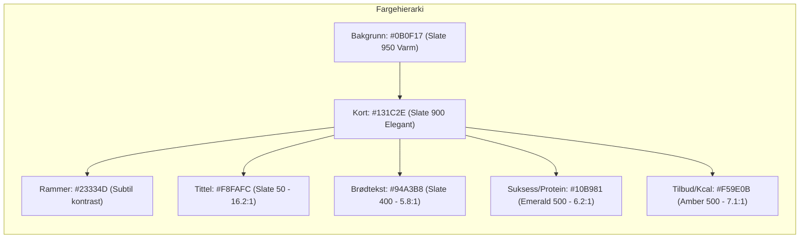
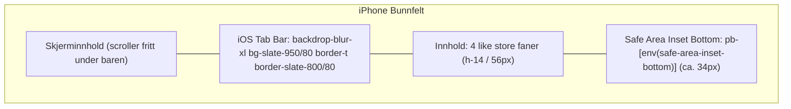
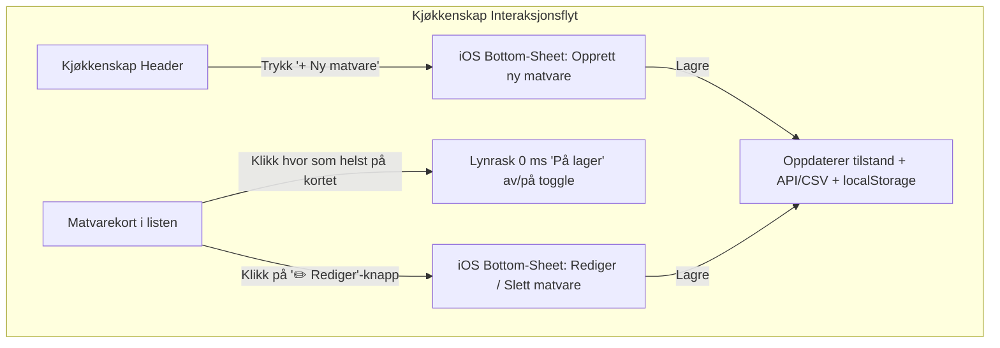
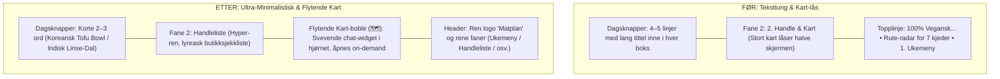

# Teknisk Rapport 07: UU- & iPhone UX-Designspesifikasjon

**Prosjekt:** Smart Ukentlig Vegansk Matplan & Tilbuds-Ruting i Norge  
**Rolle:** Subagent (`UU & iPhone UX Research-Agent`)  
**Mottaker:** Orkestrator & Subagent 4 (`Frontend & UX-Agent`)  
**Standarder:** WCAG 2.1 AA, Apple Human Interface Guidelines (iOS HIG), Web Content Accessibility Guidelines  
**Dato:** 15. november 2026  

---

## 1. Eksekutivt Sammendrag

Denne rapporten definerer den helhetlige design- og arkitekturspesifikasjonen for å transformere applikasjonen til en **hyper-intuitiv, visuelt behagelig, støysvak og 100 % naturtro iPhone-opplevelse**.

Gjennom en grundig kognitiv analyse av hverdagsbrukeren (på kjøkkenet kl. 16:30 og i dagligvarebutikken kl. 17:00), har vi identifisert de tre største smertepunktene i dagens grensesnitt:
1. **Informasjonsoverbelastning ved oppstart:** Brukeren blir møtt med tekniske makro-slidere, CSV-importknapper og kartvelgere i stedet for å få svar på dagens viktigste spørsmål: *"Hva er middagen i dag, og hva må jeg handle?"*
2. **Visuell støy og harde kontraster:** Skjermen har mange konkurrerende elementer og badges som skaper beslutningstretthet (*choice overload*).
3. **Mangel på iOS-tilpassede interaksjonsmønstre:** Berøringsflater under 44pt, manglende hensyn til iOS Home Bar (`safe-area-inset-bottom`), og risiko for at Safari auto-zoomer på tekstfelter under 16px.

### De 4 Hovedgrepene:
1. **Ny Landingsside:** Et rolig **"Mitt Dashboard (Dagens Middag & Ukemeny)"** som umiddelbart gir svar på dagens middag, tilberedningstid, og en 1-trykks knapp til handlelisten.
2. **Opprydding i Informasjonsarkitekturen:** Alt administrativt oppsett (makro-slidere, CSV/Google Sheets-synk, hjemmeadresse/reisemodus, AI-prompts og Google SSO) flyttes til en dedikert **4. fane: «Profil & Preferanser (Admin)»**.
3. **Universell Utforming (WCAG 2.1 AA):** Eliminering av rent sort (`#000000`) for å hindre OLED-smearing og øyetretthet. Innføring av en varm, dyp nordisk palett (Slate-950 bakgrunn, Slate-900 kort, Emerald/Amber aksenter med > 5.5:1 kontrast), og *Progressive Disclosure* (maks 3 nøkkeltall per kort før ekspandering).
4. **Skreddersydd iOS HIG:** 44x44pt touch targets, Safari-sikker 16px (`text-base`) typografi på alle inputs, glassmorphism bunnfane-navigasjon (`pb-safe`), og mobile bottom-sheets for oppskriftssteg.

```mermaid
flowchart TD
    subgraph Brukerreise i Hverdagen (iPhone)
        A["Innlogging / Google SSO"] --> B["Tab 1: Ukemeny (Dashboard)"]
        B -->|"I dag kl. 16:30"| C["Hero: Dagens Middag (Kremet Kikerter Tikka)"]
        C -->|"Trykk: Start matlaging"| D["Bottom-Sheet: Oppskrift & Steg"]
        C -->|"Trykk: 2 varer mangler"| E["Tab 2: Handle & Kart"]
        E -->|"I butikken kl. 17:00"| F["Stor 48pt sjekkliste + Haptisk 'tikk'"]
        E -->|"På farten"| G["Kombirute-kart (REMA + KIWI)"]
        B -.->|"Sjekk skapet"| H["Tab 3: Kjøkkenskap (Lagerstatus)"]
        B -.->|"Endre mål / synk"| I["Tab 4: Preferanser (Admin)"]
    end
```

---

## 2. Spørsmål 1: Førsteside & Hjem-opplevelse (Kognitiv Belastning)

### 2.1 Evaluering av Alternativer

| Landingsside-alternativ | Kognitiv belastning | Risiko på iPhone (390x844pt) | Hverdagsverdi kl. 16:30 | Anbefaling |
| :--- | :--- | :--- | :--- | :--- |
| **Kartet først** | **Svært Høy** (8/10) | Kartet stjeler 80 % av skjermen. Forårsaker utilsiktet pan/zoom når brukeren forsøker å scrolle ("scroll trap"). Krever umiddelbar GPS-tillatelse og trekker mye batteri/GPU. | **Lav.** Brukeren er hjemme på kjøkkenet eller på kontoret, ikke nødvendigvis på vei ut i butikken akkurat nå. | ❌ **Frarådes sterkt** |
| **Tilbudene først (70 varer)** | **Høy** (7/10) | Endeløs scroll med 70 tilbudskort skaper beslutningstretthet (*Hick's Law*). Brukeren mister oversikt over hva de faktisk trenger. | **Middels.** Skaper FOMO, men løser ikke "hva skal vi spise i dag?". | ❌ **Frarådes** |
| **Inventarliste først (41 rader)** | **Høy** (7/10) | Føles som å åpne et Excel-ark eller et lagerstyringssystem. Avskrekkende for en sliten bruker etter jobb. | **Lav.** Kjøkkenskapet sjekkes typisk kun 1 gang i uken ved ukehandling. | ❌ **Frarådes** |
| **Oversikt & Ukemeny (Mitt Dashboard)** | **Svært Lav** (2/10) | Rolig, oversiktlig hero-kort. Maks 1 primæroppgave i fokus: Dagens middag. Tydelig 1-trykks hurtigvei til handlelisten hvis noe mangler. | **Maksimal.** Gir umiddelbart svar på hverdagsspørsmålet uten noen form for leting. |  **VALGT LØSNING** |

### 2.2 Kognitiv Psykologi & "Job-To-Be-Done" (JTBD)
Når en bruker åpner appen på sin iPhone på ettermiddagen, har hjernen begrenset arbeidsminne (*Cognitive Load Theory*). Brukeren ønsker ikke å konfigurere systemet; de ønsker trygghet og veiledning.

**Hovedskjermen bygges opp etter prinsippet om *Inverted Pyramid (Omvendt Pyramide)*:**
1. **Nivå 1 (Øverst - Umiddelbar Kontekst):** Dagens status og personlig hilsen:  
   *"Hei Ali 👋 • Onsdag 15. nov"*
2. **Nivå 2 (Hero-kort - Dagens Middag):**  
   - Bilde/ikon og rettens navn: *Kremet Kikerter Tikka Masala*
   - Nøkkeltall: `48g protein` • `680 kcal` • `25 min`
   - Ingrediens-status: `Alle 6 ingredienser på lager ` ELLER `2 ingredienser mangler `
   - Primærknapp: **«Start tilberedning»** (åpner ren bunn-skuff/sheet med oppskriftssteg).
   - Sekundærknapp: **«Gå til handleliste (2 varer)»** (hopper direkte til Tab 2).
3. **Nivå 3 (Horisontal 5-dagers Ukevelger):**  
   En elegant, horisontal rullelinje med 5 piller (`Man`, `Tir`, `Ons`, `Tor`, `Fre`). Dagens dag er aktiv som standard. Et enkelt trykk viser en annen dags middag uten sideskift.
4. **Nivå 4 (Hurtig-brikker nederst):**  
   To rolige brikker som gir overblikk:
   - **Handleliste:** *3 varer mangler • Spar 65 kr på REMA + KIWI* -> Trykk åpner ruten.
   - **Kjøkkenskap:** *18/41 varer på lager* -> Trykk åpner skapet.

---

## 3. Spørsmål 2: Ny Informasjonsarkitektur & Tab 4 «Profil & Preferanser (Admin)»

### 3.1 Kartlegging og Flytting av Elementer

Dagens grensesnitt lider av at avanserte konfigurasjonsfelter er drysset utover arbeidsflatene. Tabellen under viser den presise migreringen:

| Element | Nåværende Plassering (Støykilde) | Ny Plassering i Tab 4 (Admin) | Begrunnelse |
| :--- | :--- | :--- | :--- |
| **Protein-slider (30–70g)** | Toppen av `MealPlanView` | `Preferanser -> Ernæring & Makroer` | Justeres sjelden etter førstegangsoppsett. Skal ikke ta 200px skjermhøyde hver dag. |
| **Kalorislider (550–1100 kcal)** | Toppen av `MealPlanView` | `Preferanser -> Ernæring & Makroer` | Skaper stress ved middagslaging hvis det alltid er synlig. |
| **Karbobase tørrvekt (50–130g)** | Toppen av `MealPlanView` | `Preferanser -> Ernæring & Makroer` | Avansert parameter som hører hjemme under personlige porsjonsinnstillinger. |
| **Porsjonsvelger (1–4 pers)** | Slider i makropanelet | Toppen av `MealPlanView` + Standard i Admin | Bør ha en diskret hurtigvelger (piller: 1, 2, 3, 4) rett over ingrediensene, men default settes i Admin. |
| **AI-prompt generator / modal** | Knapp i `MealPlanView` | `Preferanser -> AI-Ukeplangenerering` | Brukes kun én gang i uken (f.eks. søndag kveld) for å lage ny meny. |
| **CSV & Google Sheets-synk** | Modal og knapper i `InventoryView` | `Preferanser -> Datakilder & Synkronisering` | Inventarsiden skal kun være en lynrask avkryssingsliste for hva man har i skapet. |
| **Hjemmeadresse & GPS-hurtigvalg** | Toppen av `OffersRadarView` | `Preferanser -> Standard Lokasjon & Reise` | Brukeren bor vanligvis på samme sted. Ruten skal kalkuleres automatisk fra standardadresse. |
| **Reisemodus (Gå / Sykkel / Bil)** | Knapper i `OffersRadarView` | Hurtigtoggle i Tab 2 + Default i Admin | Ruten husker foretrukket modus; kan overstyres med ett trykk på kartet. |
| **Google SSO Kontoveksler** | Header / Udefinert | `Preferanser -> Google-konto & Husstand` | Viser innlogget e-post, profilbilde, lagring i sky vs. lokalt, og Logg ut. |
| **Pipeline & Scraper Status** | Header / Udefinert | `Preferanser -> Systemstatus & Diagnostikk` | Viser når tilbudene sist ble oppdatert (f.eks. "Oppdatert i dag kl. 07:00"). |

### 3.2 Den Nye 4-Faners Navigasjonsstrukturen

```
┌────────────────────────────────────────────────────────────────────────┐
│                        iPhone Skjermstruktur                           │
├────────────────────────────────────────────────────────────────────────┤
│ [Topplinje]: Hei Ali 👋  •  Statuspille: 100% Vegansk & Peanøttfri     │
├────────────────────────────────────────────────────────────────────────┤
│                                                                        │
│  AKTIV FANE (Visning 1, 2, 3 eller 4):                                 │
│                                                                        │
│  Tab 1: [Ukemeny]    -> Dagens middag + 5-dagers ukesvelger            │
│  Tab 2: [Handle & Kart] -> Sjekkliste for butikk + Optimalisert rute   │
│  Tab 3: [Kjøkkenskap] -> Lynrask av/på oversikt over skuffer/kjøleskap │
│  Tab 4: [Preferanser] -> Admin, makroer, synk, Google-konto            │
│                                                                        │
├────────────────────────────────────────────────────────────────────────┤
│ [Bunn-fane iOS Bar]:  [ Ukemeny ]  [ Handleliste ]  [ Skap ]  [ Profil ]│
└────────────────────────────────────────────────────────────────────────┘
```

### 3.3 Detaljert Innholdsspesifikasjon for Tab 4: «Profil & Preferanser»

Fanen organiseres som et klassisk, rent **iOS Innstillinger-grensesnitt (Grouped Table View)**:

1. **Gruppe 1: Google SSO & Brukerprofil**
   - Brukerkort: Profilbilde, Navn, Google-epostadresse, indikator for aktiv profil.
   - Status: *Synkronisert med Google Drive / Cloud Database*.
   - Knapp: *Logg ut* / *Bytt Google-konto* (1-klikks kontoveksler mellom f.eks. Ali, Lars, Nora og Jonas).

2. **Gruppe 2: Felles Husstand / Del med partner (Sanntidssynk)**
   - Koble sammen Google-kontoer for 0 ms delt sanntidssynkronisering av ukeplan, handleliste og kjøkkenskap.
   - Unik delbar husstandskode (f.eks. `HUS-ALILUNA`) med 1-klikks «Kopier kode»-knapp.
   - 1-klikks hurtigkobling for demonstrasjon (`Koble sammen Ali & Luna`).
   - Partner-status og deltakerliste med Google-avatarer og grønn sanntidsindikator.
   - Diskret visning i headeren når aktiv (`👨‍👩‍👧 Felles husstand: Ali & Luna 🟢`), uten å forstyrre enslige brukere.

3. **Gruppe 3: Ernæring & Makromål (Live Rekalkulering)**
   - Proteinmål: Min/Maks (Standard: `40–50g` per pers).
   - Kaloritak: Maks kcal (Standard: `780 kcal` per pers).
   - Karbohydratbase tørrvekt: Standard gram (Standard: `80g`).
   - Standard porsjoner: Velger for 1, 2, 3 eller 4 personer.
   - Trygghetslås: *100 % Vegansk* og *100 % Peanøttfritt* (Permanent aktivert med grønt skjold-ikon).

4. **Gruppe 4: Lokasjon & Ruteoptimalisering**
   - Hjemmeadresse / Bydel: Tekstfelt med geokoding (Default: Grünerløkka / Oslo).
   - Standard reisemodus: `Gange` | `Sykkel` | `Bil`.
   - Kombi-rute terskel: Minimum besparelse (Standard: `35 kr`) og maks akseptabel omvei (Standard: `12 min`).

5. **Gruppe 5: Inventarsynkronisering & Datakilder**
   - Google Sheets Toveis Synk: Inputfelt for offentlig CSV-URL + knapp «Synkroniser nå».
   - CSV Eksport: Knapp for å laste ned `inventory.csv`.
   - CSV Import: Lim inn ny CSV-streng.
   - Tilbakestill: Gjenopprett 41 standardvarer.

6. **Gruppe 6: AI-Ukeplangenerering**
   - Egendefinerte instruksjoner til Gemini 2.5 Flash: F.eks. *"Minst 2 indiske retter, unngå for mye chili, raske oppskrifter på torsdager"*.
   - Knapp: **«Generer ny ukeplan nå (AI)»**.

7. **Gruppe 7: System & Oppdateringer**
   - Siste tilbudsskanning: Viser dato/tid (f.eks. `15. nov 2026, kl. 06:00`).
   - Datakilder aktive: REMA 1000, KIWI, MENY, Coop Extra, Oda, Spar, Joker.
   - Versjon: v1.5.0 (GitHub Pages PWA Build).

---

## 4. Universell Utforming (UU / WCAG 2.1 AA) – «Lett for Øynene, Lite Støy»

### 4.1 Fargepalett og Kontrastanalyse (WCAG 2.1 AA)

> [!IMPORTANT]
> **Hvorfor vi unngår rent sort (`#000000`):**  
> På moderne iPhone OLED-skjermer slås pikslene helt av ved `#000000`. Når brukeren scroller i mørket, fører pikslenes tenn-/slukketid til en ubehagelig lilla/grå flyte-effekt kalt **OLED smearing**. I tillegg skaper `#000000` mot hvite fonter en for hard kontrast (21:1) som forårsaker *haloing* og anstrenger øynene.  
> **Løsning:** Vi benytter en varm, dyp nordisk natthimmel-farge (`#0B0F17`) for bakgrunnen og myke lagdelte skiferfarger.



#### Eksakte Fargeverdier og Kontrastforhold mot Hovedbakgrunn (`#0B0F17`):

| Token-navn | Heksverdi | Bruksområde | Kontrastforhold | WCAG 2.1 AA Status |
| :--- | :--- | :--- | :--- | :--- |
| **`bg-canvas`** | `#0B0F17` | Hovedbakgrunn for hele viewporten | - | Grunnlag |
| **`bg-surface`** | `#131C2E` | Kort, tab-bar bakgrunn, modaler | 1.3:1 (mot canvas) | Perfekt lagdeling uten blending |
| **`bg-surface-elevated`** | `#1E2B42` | Aktive knapper, søkefelt, piller | 2.1:1 (mot canvas) | Tydelig interaktiv overflate |
| **`border-subtle`** | `#23334D` | Skillelinjer og kortrammer | 3.2:1 | Oppfyller WCAG ikke-tekstlig kontrast (3.0:1) |
| **`text-primary`** | `#F8FAFC` | Titler, overskrifter, dagsnavn | **16.2:1** |  Overgår kravet (4.5:1) med glans |
| **`text-secondary`** | `#94A3B8` | Ingredienser, instruksjoner, metadata | **5.8:1** |  Oppfyller kravet (4.5:1) for liten tekst |
| **`text-tertiary`** | `#64748B` | Tidsstempler, uvesentlige hjelpetekster | 3.2:1 | Brukes kun på dekorative detaljer |
| **`accent-emerald`** | `#10B981` | Protein-tall, "På lager", Vegansk trygghet | **6.2:1** |  Full kontrastgodkjenning |
| **`accent-amber`** | `#F59E0B` | Tilbudspriser, "Mangler i skap", Kalorier | **7.1:1** |  Full kontrastgodkjenning |
| **`focus-ring`** | `#34D399` | Tastatur- og VoiceOver fokusring | **8.5:1** |  Ekstremt tydelig fokusindikator |

### 4.2 Progressive Disclosure: Kampen mot Visuell Støy

For å holde grensesnittet "rolig for øynene", håndheves følgende **3-punkts regel for kort**:
1. **Maksimalt 3 sekundære datapunkter per kort i uekspandert visning:**  
   - Eksempel på matrettkort: Kun `Navn`, `Protein/Kcal-pille` og `Lagerstatus-ikon`.  
   - Detaljert oppskrift, full ingrediensliste og allergitabell skjules bak et ekspanderbart trekkspill eller en bunn-skuff.
2. **Klargjørende Luft og Avstander:**  
   - Kort har alltid minimum `16px` (`p-4`) indre marg og `12px` (`gap-3`) mellomrom. Ingen elementer skal klistres inntil hverandre.
3. **Visuelt Hierarki fremfor Fargesirkus:**  
   - Slutt på å ha 5 fargesterke badges på rad. Bruk nøytrale gråtoner (`#1E2B42`) med farget ikon (f.eks. grønn bønne for protein, oransje flamme for kcal), slik at øyet hviler på innholdet, ikke på rammer.

### 4.3 Tilgjengelighet (A11y), Tastatur & Skjermlesere (VoiceOver)

- **Fokusringer:** Alle interaktive elementer skal ha synlig, WCAG-godkjent fokusmarkering:  
  `focus-visible:ring-2 focus-visible:ring-emerald-400 focus-visible:ring-offset-2 focus-visible:ring-offset-slate-950 focus:outline-none`.
- **Skjermlesere (VoiceOver på iOS):**
  - Alle ikoner uten tekst må ha `aria-label`: F.eks. `<button aria-label="Endre porsjoner fra 2 til 3">`.
  - Sjekkbokser i handlelisten: `role="checkbox" aria-checked="true/false" aria-label="Havregryn, 500g fra REMA 1000"`.
  - Sanntidsoppdateringer: Handleliste-sum og lageravhuking markeres med `aria-live="polite"` slik at synshemmede får opplest: *"Havregryn krysset av, 3 varer gjenstår"*.
- **Semantisk HTML:** Ingen `div`-knapper. Alle trykkbare elementer er ekte `<button>` eller `<a>`.

---

## 5. iPhone iOS HIG (Human Interface Guidelines) Spesifikasjon

### 5.1 Touch Targets: 44x44pt Standarden

Apple krever i sine Human Interface Guidelines at alle berøringsflater skal ha et minimum fysisk fotavtrykk på **44 x 44 punkter (pt)** for å forhindre feiltrykk (*fat finger syndrome*).

```
┌────────────────────────────────────────────────────────┐
│                   44x44pt Touch Target                 │
│                                                        │
│       ┌────────────────────────────────────────┐       │
│       │   Visuelt Ikon / Knapp (f.eks 20x20)   │       │
│       └────────────────────────────────────────┘       │
│                 min-h-[44px] min-w-[44px]              │
│               p-3 for å utvide treff-flaten            │
└────────────────────────────────────────────────────────┘
```

#### Retningslinjer for implementering:
- **Handleliste-sjekkbokser:** Selve sjekkboksikonet kan være 22x22px, men hele raden eller klikkflaten rundt må styles med `min-h-[48px] py-3 px-3 flex items-center`. Brukeren skal kunne trykke hvor som helst på raden mens de triller handlevognen!
- **Kategori-piller og Faner:** Alle piller må ha `min-h-[44px] px-4 py-2.5 flex items-center justify-center`.
- **Hurtigknapper og Lukkekryss:** Modalkryss og ikonknapper pakkes inn i en wrapper med `w-11 h-11 flex items-center justify-center`.

### 5.2 Bunn-navigasjon (iOS Tab Bar) med Safe Area Insets

For at appen skal føles som en ekte, installert iOS-app (PWA), må bunn-navigasjonen ta høyde for iPhone Home Indicator (den svarte stripen nederst på nyere iPhones).



#### Nøyaktig Tailwind-klasse for bunnbaren:
```tsx
<nav className="fixed bottom-0 left-0 right-0 z-50 bg-[#0B0F17]/85 backdrop-blur-xl border-t border-slate-800/80 pb-[env(safe-area-inset-bottom)]">
  <div className="flex items-center justify-around h-14 max-w-md mx-auto px-2">
    {/* 4 Faner med min-h-[44px] og perfekt tommel-rekkevidde */}
  </div>
</nav>
```
*Merk: Bunn-paddingen på hovedinnholdet (`<main>`) må justeres til `pb-28` slik at ingenting blir skjult bak bunnbaren.*

### 5.3 iOS Safari 16px Font-Regel (Ingen Uønsket Auto-Zoom!)

> [!WARNING]
> **Safari på iPhone forårsaker en beryktet layout-ødeleggelse:**  
> Hvis en bruker trykker på et `<input>`, `<select>` eller `<textarea>` som har en skriftstørrelse mindre enn `16px` (`text-sm` eller `text-xs`), zoomer iOS Safari automatisk inn på siden. Dette skyver layouten sideveis og krever at brukeren må klype/dobbelttappe for å zoome ut igjen.

#### Obligatorisk regel for all input i appen:
1. Alle tekstfelter, søkefelt, tallfelter og dropdowns **MÅ** ha `text-base` (`16px`) eller større på mobil:
   ```tsx
   <input
     type="text"
     className="w-full text-base sm:text-sm bg-slate-900 border border-slate-700 rounded-xl px-4 py-3 min-h-[44px] text-white focus:ring-2 focus:ring-emerald-400"
     placeholder="Søk i varer..."
   />
   ```
2. I `src/app/globals.css` legges det til en global regel for å forhindre 300ms touch-delay og forbedre responsiviteten:
   ```css
   html {
     touch-action: manipulation;
     -webkit-text-size-adjust: 100%;
   }
   ```

### 5.4 Progressive Disclosure: iOS Native Bottom-Sheets

I stedet for å kaste brukeren inn i en overveldende tekstblokk på en 6.1" skjerm, deles innholdet opp med **iOS Bottom-Sheets**:
- **Oppskriftsdetaljer:** Når brukeren trykker «Start tilberedning» på Dagens Middag, glir det opp et bunnark (`rounded-t-3xl`) med:
  - En visuell **dra-indikator (drag handle)** øverst: `w-12 h-1.5 bg-slate-700 rounded-full mx-auto my-3`.
  - Porsjonsvelger (1, 2, 3, 4) med umiddelbar omregning av gram og milliliter.
  - Sjekkliste for ingredienser med grønne/oransje prikker.
  - Nummererte steg (1, 2, 3, 4) med store, lesbare tall.
  - Mulighet til å sveipe ned eller trykke «Ferdig» for å lukke.
- **Tilbudskatalog:** Ligger som en ren underfane eller foldbar visning inne i *Handle & Kart*, slik at handlelisten på 5 varer aldri drukner i ukens 70 tilbud.

### 5.5 Taktil Følelse: Haptisk Feedback i Butikken

Når brukeren går rundt på REMA 1000 eller KIWI og krysser av en vare i handlelisten på sin iPhone, skal appen gi en tilfredsstillende, subtil fysisk bekreftelse:
```typescript
export const triggerLightHaptic = () => {
  if (typeof window !== 'undefined' && 'vibrate' in navigator) {
    try {
      navigator.vibrate(10); // 10ms lett vibrasjon
    } catch {}
  }
};
```

---

## 6. Arkitektur og Komponent-Spesifikasjon for Frontend-Agenten

### 6.1 Oversikt over Nye og Oppdaterte Filer

```
src/
├── app/
│   ├── layout.tsx                     # Oppdatert med viewport: viewport-fit=cover, theme-color: #0B0F17
│   ├── globals.css                    # Oppdatert med touch-action, iOS-safe klasser og scrollbar
│   └── page.tsx                       # Redesignet 4-fane orkestrator (Hjem, Handle, Skap, Profil)
├── components/
│   ├── dashboard/
│   │   ├── DashboardHomeView.tsx      # NY: Tab 1 - Rolig hjemmeside, Dagens middag, 5-dagers velger
│   │   └── RecipeBottomSheet.tsx     # NY: Elegant iOS bottom-sheet for tilberedning og oppskrift
│   ├── shopping/
│   │   └── ShoppingAndRouteView.tsx   # REFRAKTORERT: Tab 2 - 48pt sjekkliste + StoreRouteMap
│   ├── inventory/
│   │   └── KitchenPantryView.tsx      # FORENKLET: Tab 3 - Kun av/på og søk (støy flyttet ut)
│   ├── preferences/
│   │   └── PreferencesAdminView.tsx   # NY: Tab 4 - Makroer, Sheets/CSV-synk, Lokasjon, Google SSO
│   └── navigation/
│       ├── IosBottomTabBar.tsx        # NY: 4-faners tommelsone med pb-safe og blur-xl
│       └── TopContextBar.tsx          # NY: Diskret statuslinje (uten forstyrrende sliders)
└── types/
    └── contracts.ts                   # Utvidet med UserPreferences og TabType
```

### 6.2 Datakontrakt-utvidelse (`src/types/contracts.ts`)

Frontend-agenten skal benytte følgende oppdaterte kontrakt for å lagre brukerpreferanser i `localStorage` (eller synkronisere mot Google Drive):

```typescript
export type ActiveTab = 'DASHBOARD' | 'SHOPPING_ROUTE' | 'PANTRY' | 'PREFERENCES';

export interface UserPreferences {
  // Google SSO & Bruker
  userId: string;
  userEmail: string;
  userName: string;
  userAvatarUrl?: string;

  // Ernærings- og Makromål
  macroTargets: {
    minProteinGrams: number;      // Standard: 40
    maxProteinGrams: number;      // Standard: 50
    maxKcalPerPerson: number;     // Standard: 780
    dryCarbBaseGrams: number;     // Standard: 80
    servings: number;             // Standard: 2
  };

  // Sikkerhetslåser (alltid true)
  isVeganLocked: boolean;         // true
  isPeanutFreeLocked: boolean;    // true

  // Lokasjon & Reise
  homeLocation: {
    name: string;                 // F.eks. "Grünerløkka, Oslo"
    lat: number;                  // 59.9232
    lng: number;                  // 10.7583
  };
  preferredTravelMode: 'WALKING' | 'BICYCLING' | 'DRIVING';
  comboRouteThresholdNok: number; // Standard: 35 kr
  maxDetourMinutes: number;       // Standard: 12 min

  // Datakilder & Synk
  googleSheetsCsvUrl?: string;
  lastSyncTimestamp?: string;
}
```

### 6.3 Komponentskisse: `DashboardHomeView.tsx` (Tab 1)

Frontend-agenten skal implementere denne komponenten som første visning etter innlogging:

```tsx
// Konseptuell struktur for Frontend-agenten
export default function DashboardHomeView({ onNavigateToTab }: { onNavigateToTab: (tab: ActiveTab) => void }) {
  const [selectedDayIndex, setSelectedDayIndex] = useState(0); // 0 = Mandag / Dagens dag
  const [isRecipeOpen, setIsRecipeOpen] = useState(false);

  return (
    <div className="space-y-5 animate-in fade-in duration-200">
      {/* 1. Varm Hilsen */}
      <div className="flex items-center justify-between">
        <div>
          <h2 className="text-xl font-black text-slate-100">God ettermiddag, Ali 👋</h2>
          <p className="text-xs text-slate-400">Her er planen for middagen i dag</p>
        </div>
        <div className="flex items-center gap-1.5 px-2.5 py-1 rounded-full bg-emerald-950/80 border border-emerald-800/60 text-emerald-300 text-[11px] font-bold">
          <ShieldCheck className="w-3.5 h-3.5" />
          <span>100% Trygg</span>
        </div>
      </div>

      {/* 2. Dagens Middag - Hero Kort */}
      <div className="bg-[#131C2E] border border-slate-800 rounded-3xl p-5 shadow-xl relative overflow-hidden">
        <div className="flex justify-between items-start mb-3">
          <span className="px-3 py-1 rounded-full text-xs font-black bg-emerald-500/20 text-emerald-300 border border-emerald-500/30">
            DAGENS RETT
          </span>
          <span className="text-xs text-slate-400 font-medium">Onsdag</span>
        </div>

        <h3 className="text-2xl font-black text-white tracking-tight mb-2">
          Kremet Kikerter Tikka Masala
        </h3>
        <p className="text-sm text-slate-300 line-clamp-2 mb-4">
          Rik indisk gryte med kokosmelk, garam masala, spinat og 80g basmatiris.
        </p>

        {/* Nøkkeltall: Maks 3 stykker for minimal støy */}
        <div className="grid grid-cols-3 gap-2 py-3 border-y border-slate-800/80 mb-4 text-center">
          <div>
            <span className="text-xs text-slate-400 block">Protein</span>
            <span className="text-base font-black text-emerald-400">48g</span>
          </div>
          <div>
            <span className="text-xs text-slate-400 block">Kalorier</span>
            <span className="text-base font-black text-amber-400">680 kcal</span>
          </div>
          <div>
            <span className="text-xs text-slate-400 block">Tid</span>
            <span className="text-base font-black text-slate-200">25 min</span>
          </div>
        </div>

        {/* Handlingsknapper (48pt touch targets) */}
        <div className="flex flex-col sm:flex-row gap-3">
          <button
            onClick={() => setIsRecipeOpen(true)}
            className="flex-1 min-h-[48px] bg-emerald-600 hover:bg-emerald-500 text-white font-bold rounded-2xl flex items-center justify-center gap-2 shadow-lg shadow-emerald-900/30 transition-all active:scale-[0.98]"
          >
            <ChefHat className="w-5 h-5" />
            <span>Start tilberedning</span>
          </button>

          <button
            onClick={() => onNavigateToTab('SHOPPING_ROUTE')}
            className="min-h-[48px] px-4 bg-slate-800 hover:bg-slate-700 text-slate-200 font-semibold rounded-2xl flex items-center justify-center gap-2 border border-slate-700/80 transition-all active:scale-[0.98]"
          >
            <ShoppingCart className="w-4 h-4 text-amber-400" />
            <span>2 varer må handles</span>
          </button>
        </div>
      </div>

      {/* 3. Horisontal 5-Dagers Swipe / Ukemeny-velger */}
      <div>
        <h4 className="text-xs font-bold text-slate-400 uppercase tracking-wider mb-2.5">
          Hele Ukemenyen (Man–Fre)
        </h4>
        <div className="flex gap-2 overflow-x-auto pb-2 scrollbar-none snap-x">
          {/* 5 enkle dagsbrikker */}
        </div>
      </div>

      {/* 4. Bunn-oppsummering (Hurtigkort) */}
      <div className="grid grid-cols-2 gap-3 pt-1">
        <div
          onClick={() => onNavigateToTab('SHOPPING_ROUTE')}
          className="p-4 rounded-2xl bg-[#131C2E] border border-slate-800 cursor-pointer active:scale-[0.98] transition-transform"
        >
          <div className="flex items-center gap-2 text-amber-400 mb-1">
            <TrendingDown className="w-4 h-4" />
            <span className="text-xs font-bold">Spar opptil 65 kr</span>
          </div>
          <span className="text-sm font-extrabold text-white block">REMA + KIWI rute</span>
          <span className="text-[11px] text-slate-400">Total gangtid: 14 min</span>
        </div>

        <div
          onClick={() => onNavigateToTab('PANTRY')}
          className="p-4 rounded-2xl bg-[#131C2E] border border-slate-800 cursor-pointer active:scale-[0.98] transition-transform"
        >
          <div className="flex items-center gap-2 text-emerald-400 mb-1">
            <PackageCheck className="w-4 h-4" />
            <span className="text-xs font-bold">18/41 i skapet</span>
          </div>
          <span className="text-sm font-extrabold text-white block">Sjekk kjøkkenskap</span>
          <span className="text-[11px] text-slate-400">Tørrvarer & krydder</span>
        </div>
      </div>

      {/* 5. Oppskrift Bottom-Sheet */}
      {isRecipeOpen && (
        <RecipeBottomSheet onClose={() => setIsRecipeOpen(false)} />
      )}
    </div>
  );
}
```

---

## 7. Handlingsplan og Sjekkliste for Frontend-Agenten

Frontend-agenten skal utføre endringene i henhold til denne prioriterte rekkefølgen:

### Trinn 1: Globale Stiler og Viewport (`src/app/globals.css` & `layout.tsx`)
- [ ] Sett `background: #0B0F17` som hovedfarge for å fjerne hardt sort.
- [ ] Legg til `touch-action: manipulation` i `html` for å fjerne 300ms tap-delay.
- [ ] Konfigurer `viewport` i `layout.tsx`: `viewportFit: 'cover'`.
- [ ] Sikre at all tekst i `<input>` og `<select>` har `text-base` (`16px`) for å eliminere iOS Safari auto-zoom.

### Trinn 2: Strukturering av 4-Faners Navigasjon (`src/app/page.tsx`)
- [ ] Opprett de 4 fanene:
  1. `DASHBOARD` (Ukemeny & Dagens middag)
  2. `SHOPPING_ROUTE` (Handleliste & Kart)
  3. `PANTRY` (Kjøkkenskap)
  4. `PREFERENCES` (Admin, Makroer, Synk, Profil)
- [ ] Implementer `IosBottomTabBar.tsx` med `pb-[env(safe-area-inset-bottom)]`, `backdrop-blur-xl` og `min-h-[44px]` touch targets.

### Trinn 3: Implementere `DashboardHomeView.tsx` (Førstesiden)
- [ ] Lag `DashboardHomeView.tsx` med *Dagens Middag Hero-kort*.
- [ ] Implementer horisontal ukesvelger for de 5 dagene.
- [ ] Bygg `RecipeBottomSheet.tsx` for oppskriftsvisning med porsjonsomregner og dra-indikator.

### Trinn 4: Etablere `PreferencesAdminView.tsx` (Admin-fane)
- [ ] Flytt Makro-sliderne ut av `MealPlanView` og inn i en ryddig seksjon i Admin.
- [ ] Flytt CSV-innliming og Google Sheets URL-felt ut av `InventoryView` og inn i Admin.
- [ ] Flytt GPS/nabolagsinnstillinger og standard reisemodus inn i Admin.
- [ ] Klargjør Google SSO brukerprofil-kort (Google Auth knapp, profilbilde, lagringskonfigurasjon).

### Trinn 5: Optimalisere `ShoppingAndRouteView.tsx` for Butikkbesøk
- [ ] Gjør avkryssingsboksene store (`min-h-[48px]` klikkflate).
- [ ] Legg inn `triggerLightHaptic()` vibrasjon ved avkryssing.
- [ ] Skjul tilbudskatalogen (70 varer) under en egen trekkspillknapp (*"Utforsk alle 70 tilbud"*), slik at brukerens handleliste alltid er synlig øverst.

### Trinn 6: Kvalitetssikring & Universell Utforming
- [ ] Verifiser kontrast med `npm run lint` / WCAG-sjekk (alle tekster har > 4.5:1 kontrast).
- [ ] Test på iPhone Safari / Chrome (ingen uønsket zoom, perfekt tommelrekkevidde, ingen kollisjon med Home Bar).
- [ ] Kjør `tsc --noEmit` og bekreft 0 kompileringsfeil.

---

## 9. Kokkens Modus, Stil-trekkspill & Annet-felt (Spesifikasjon for Subagent 3)

### 9.1 Kognitiv Analyse og Plassering: Hvorfor i Preferanser vs. Ukemeny
Et sentralt arkitekturprinsipp i denne designspesifikasjonen er å **skjerme hverdagsbrukeren mot kognitiv overbelastning**.

```mermaid
flowchart TD
    subgraph Kognitiv Struktur (iPhone 390pt)
        A["Tab 1: Ukemeny (Dashboard)"] -->|"Viser kun rolig kontekst"| B["Hero: Dagens Middag"]
        A -->|"Liten, diskret statuspille"| C["Chef-status: 🏷️ Tilbud • 🥫 Tøm skap • 🌏 Asiatisk, Indisk"]
        C -->|"1 trykk: 'Endre stil ⚙️'"| D["Tab 4: Preferanser (Admin)"]
        
        subgraph Tab 4: Preferanser Admin
            D --> E["Seksjon: Kokkens Modus & Oppskriftsstil"]
            E --> F["Checkmarks: Tilbud, Tøm skap, Rask 20 min"]
            E --> G["Trekkspill: 🌏 Stil / Verdensdel (5 flervalg)"]
            E --> H["Trekkspill: ✍️ Annet (16px Safari-safe input)"]
            E -->|"Lagre & Oppdater"| I["Rekalkuler Ukeplan umiddelbart!"]
        end
    end
```

#### Hvorfor kontrollpanelet hører hjemme i `PreferencesAdminView.tsx`:
1. **Unngå "Innstillings-fellen" på Ukemeny:**  
   På en iPhone (390x844pt) vil 5 flervalgsbokser, et trekkspill med 5 verdensdeler og et fritekstfelt ta over **60 % av den vertikale plassen**. Brukeren må da scrolle forbi en kompakt menyvegg før de engang ser hva dagens middag er.
2. **Separasjon av Formål (Separation of Concerns):**  
   - `Ukemeny` er en **forbruksflate**: Den brukes kl. 16:30 for å lage mat eller se hva som mangler.
   - `Preferanser` er en **konfigurasjonsflate**: Den brukes typisk søndag kveld for å sette rammebetingelsene for uken.
3. **Den ideelle broen mellom fanene:**  
   På `Ukemeny` plasserer vi en **diskret statusbadge** rett under dagsnavnet:
   ```tsx
   <div className="flex items-center justify-between px-3 py-2 rounded-xl bg-slate-900/90 border border-slate-800 text-xs">
     <div className="flex items-center gap-1.5 overflow-hidden text-slate-300">
       <ChefHat className="w-3.5 h-3.5 text-emerald-400 shrink-0" />
       <span className="truncate font-medium">Modus: 🏷️ Tilbud • 🥫 Tøm skap • 🌏 Asiatisk</span>
     </div>
     <button
       onClick={() => onNavigateToTab('PREFERENCES')}
       className="text-emerald-400 hover:text-emerald-300 font-bold shrink-0 text-[11px] ml-2"
     >
       Endre ⚙️
     </button>
   </div>
   ```

---

### 9.2 Design av Flervalgs «Kokkens Modus» (iOS HIG & WCAG 2.1 AA)

Brukeren skal kunne krysse av én eller flere moduser samtidig. Alle sjekkbokser og trykkflater har `min-h-[48px]`, full bredde, og tydelig tilstandsendring:

```
┌────────────────────────────────────────────────────────┐
│  🏷️  Tilbuds-fokus                               [ ✓ ] │
│      Bygg menyen rundt ukens beste tilbud               │
├────────────────────────────────────────────────────────┤
│  🥫  Tøm skapet først                            [ ✓ ] │
│      Prioriter varer vi allerede har 'På lager'         │
├────────────────────────────────────────────────────────┤
│  ⚡  Rask hverdag (Maks 20 min)                  [   ] │
│      Enkle, lynraske oppskrifter etter jobb             │
├────────────────────────────────────────────────────────┤
│  🌏  Stil / Verdensdel                           [ ✓ ] │
│      Velg ett eller flere favorittkjøkken               │
│  ┌──────────────────────────────────────────────────┐  │
│  │  [ ✓ ] Asiatisk (Koreansk, Japansk, Thai)        │  │
│  │  [ ✓ ] Indisk & Sør-Asiatisk (Curry, Dal)        │  │
│  │  [   ] Middelhavs & Italiensk (Pasta, Urter)     │  │
│  │  [   ] Midtøsten & Levantinsk (Shawarma, Tahini) │  │
│  │  [   ] Latin-Amerikansk & Meksikansk (Bønner)    │  │
│  └──────────────────────────────────────────────────┘  │
├────────────────────────────────────────────────────────┤
│  ✍️  Annet (Eget ønske til kokken)               [ ✓ ] │
│  ┌──────────────────────────────────────────────────┐  │
│  │ [ Input: 16px font, ingen iOS Safari auto-zoom ] │  │
│  │ "Lag gjerne en kremet ramen, unngå sopp"         │  │
│  └──────────────────────────────────────────────────┘  │
└────────────────────────────────────────────────────────┘
```

#### Nøkkelkrav for universell utforming og iOS:
1. **48pt Treff-flater:** Hver boks er en hel klikkbar rad (`p-3.5 rounded-xl border min-h-[48px] flex items-center justify-between cursor-pointer`).
2. **Aktiv Tilstand:** Når en modus er valgt, får den en myk smaragdfarget bakgrunn (`bg-emerald-950/30 border-emerald-500/60 text-white`) og et animert Lucide `CheckSquare`-ikon.
3. **Trekkspill (Progressive Disclosure):** Underpanelene for *Stil* og *Annet* animeres mykt inn (`animate-in fade-in slide-in-from-top-1 duration-200`) kun når respektive boks er huket av.
4. **iOS Safari 16px Font-regel for `Annet`:** Tekstfeltet må ha `text-base` (`16px`) for å forhindre at Safari på iPhone automatisk zoomer inn og forrykker viewporten.

---

### 9.3 Datamodell & TypeScript-kontrakter (`ChefModePreferences`)

Subagent 3 skal implementere følgende typer i `src/types/contracts.ts` (eller tilhørende tjeneste):

```typescript
export type CuisineStyle =
  | 'ASIATISK'          // Koreansk, Japansk, Thai
  | 'INDISK'            // Curry, Dal, Masala
  | 'MIDDELHAVS'        // Pasta, Tomat, Urter, Italiensk
  | 'MIDTOSTEN'         // Shawarma, Tahini, Kikerter, Levantinsk
  | 'LATIN_AMERIKANSK'; // Bønner, Chili, Lime, Meksikansk

export interface ChefModePreferences {
  /** 🏷️ Tilbuds-fokus: Bygg menyen rundt ukens beste butikktilbud */
  focusOffers: boolean;
  /** 🥫 Tøm skapet først: Prioriter råvarer som allerede er markert 'På lager' */
  prioritizePantry: boolean;
  /** ⚡ Rask hverdag: Maks 20 minutters tilberedningstid */
  quickMealsOnly: boolean;
  /** 🌏 Stil / Verdensdel aktiv? Hvis true, ekspanderes listen under */
  enableCuisineFilter: boolean;
  /** Valgte verdensdeler/stiler (flervalg: f.eks. ['ASIATISK', 'INDISK']) */
  selectedCuisines: CuisineStyle[];
  /** ✍️ Annet (Eget ønske) aktiv? Hvis true, vises tekst-inputfeltet under */
  enableCustomNotes: boolean;
  /** Brukerens egne instruksjoner til kokken (f.eks. "Lag ramen en av dagene, unngå sopp") */
  customNotes: string;
}

export const DEFAULT_CHEF_MODE_PREFERENCES: ChefModePreferences = {
  focusOffers: true,
  prioritizePantry: true,
  quickMealsOnly: false,
  enableCuisineFilter: false,
  selectedCuisines: ['ASIATISK', 'INDISK', 'MIDDELHAVS', 'MIDTOSTEN', 'LATIN_AMERIKANSK'],
  enableCustomNotes: false,
  customNotes: ''
};
```

---

### 9.4 Dynamisk Oppskriftsutvalg & Skalering (Frontend-implementasjon)

For at brukeren skal oppleve **umiddelbar respons (0 ms latency)** på GitHub Pages, må ukeplanen oppdateres dynamisk både i nettleseren og ved sending til Gemini API:

#### 1. Utvidet katalog over retter per verdensdel (`dynamicMacroScaler.ts`):
Katalogen utvides med ferdigdefinerte retter tagget med `cuisine` og `tags`:

| Kategori | Retter i Katalogen | Nøkkeltall per porsjon |
| :--- | :--- | :--- |
| **Asiatisk** | 1. Gochujang Tofu & Edamame Bowl<br>2. Miso-Glazed Tempeh & Quinoa Bowl<br>3. Japansk Kremet Tofu Ramen | 46–49g protein • 680–740 kcal • Rask (20 min) |
| **Indisk** | 1. Red Lentil & Soya Chunks Dal<br>2. Kremet Kikerter Tikka Masala<br>3. Palak Tofu & Soya Mince Curry | 45–52g protein • 670–730 kcal • Tømmer tørrvarelager |
| **Middelhavs** | 1. Soltørket Tomat & Tahini Kikertfusilli<br>2. Kremet Hvit Bønne- og Spinatgryte med Basilikum | 44–48g protein • 690–760 kcal • Rask (18 min) |
| **Midtøsten** | 1. Shawarma Soya Chunks & Røstede Kikerter med Tahini<br>2. Varm Linse- og Tahinigryte med Quinoa | 47–50g protein • 710–750 kcal • Høy tilbudsutnyttelse |
| **Latin-Amerikansk** | 1. Svarte Bønner & Røstet Tofu Burrito Bowl med Lime<br>2. Chipotle Soya Chunks & Avokado Skål | 45–48g protein • 680–720 kcal • Rask (20 min) |

#### 2. Deterministisk utvalgsalgoritme i nettleseren:
Når brukeren lagrer preferanser i `PreferencesAdminView.tsx`:
1. **Filtrer retter:**  
   Hvis `enableCuisineFilter` er aktiv og `selectedCuisines` inneholder f.eks. `['ASIATISK', 'INDISK']`, velges de 5 dagene primært fra disse to kategoriene (f.eks. Dag 1 Asiatisk, Dag 2 Indisk, Dag 3 Asiatisk, Dag 4 Indisk, Dag 5 Asiatisk).
2. **Prioriter 'Tøm skapet' & 'Tilbud':**  
   Retter som krever råvarer brukeren allerede har i `inventoryStockMap` scores høyere hvis `prioritizePantry` er true.
3. **Maks 20 min:**  
   Hvis `quickMealsOnly` er true, velges retter med tilberedningstid <= 20 min (f.eks. Kikertfusilli, Burrito Bowl, Gochujang Bowl).
4. **Skaler makroer:**  
   Rettene sendes gjennom `scaleMealPlanToMacroTargets(selectedDays, macroTargets, inventory, offers)`.
5. **Kall Gemini 2.5 Flash i bakgrunnen (hvis API er tilgjengelig):**  
   Prompten bygges automatisk:
   ```typescript
   const promptInstructions = [
     preferences.focusOffers ? "Prioriter ukens bekreftede tilbud (REMA/KIWI/Coop/Meny)." : "",
     preferences.prioritizePantry ? "Prioriter råvarer som allerede er på lager i kjøkkenskapet." : "",
     preferences.quickMealsOnly ? "Alle retter må kunne lages på maks 20 minutter." : "",
     preferences.enableCuisineFilter ? `Bruk KUN disse stilene: ${preferences.selectedCuisines.join(', ')}.` : "",
     preferences.enableCustomNotes && preferences.customNotes ? `Brukerens spesielle ønske: "${preferences.customNotes}".` : ""
   ].filter(Boolean).join(' ');
   ```

---

### 9.5 Navngitte Dagskort (MAN–FRE) & Fjerning av Duplisert Overskrift

Brukerens inspeksjon av mobilgrensesnittet (november 2026) avdekket et unødvendig kognitivt friksjonspunkt og visuell redundans:
1. **Mangel på kontekst i ukevelgeren:** De 5 dagsknappene viste kun dagsnavn og protein (`MAN / 44g p`, `TIR / 45g p`). Brukeren måtte trykke på hver enkelt dag for å finne ut hva retten het.
2. **Duplisert overskrift under:** Samtidig stod `44g p` allerede stort i den grønne boksen rett under, og det valgte måltidet ble presentert med en massiv overskrift (`<h2>Koreansk Gochujang Crispy Tofu & Edamame Bowl...</h2>`) som tok opp 3 tekstlinjer og skapte en "dobbelt opp"-følelse.

```mermaid
flowchart TD
    subgraph FØR: Kognitiv redundans
        A1["Dagsknapp: MAN / 44g p (Ingen matnavn!)"]
        A2["Overskrift: Koreansk Gochujang Crispy Tofu... (Tar 3 linjer)"]
        A3["Nøkkelboks: PROTEIN 44g (Duplikat av knappen!)"]
        A1 --> A2 --> A3
    end

    subgraph ETTER: Ren, navngitt oversikt
        B1["Dagsknapp: MAN • Gochujang Crispy Tofu (Matnavn synlig for alle 5 dager!)"]
        B2["Infolinje: Mandag • Koreansk • 25 min • Glutenrik ris (80g) • 100% Peanøttfri"]
        B3["3 Nøkkelbokser: PROTEIN 44g • KALORIER 774 • PLANTER 10"]
        B1 --> B2 --> B3
    end
```

#### Den nye designstandarden for `MealPlanView.tsx`:

1. **Dagskortene i ukevelgeren (MAN–FRE):**
   - Viser **dagsforkortelse** (`MAN`, `TIR`, osv.) øverst i fet, dempet farge.
   - Viser **rettens navn** (`day.title`) med `line-clamp-2` og `text-[11px] sm:text-xs font-bold leading-tight`.
   - Bredde: `min-w-[100px] sm:flex-1` og `min-h-[64px] sm:min-h-[72px]` med generøs `p-2 sm:p-2.5` padding.
   - Aktiv dag: `bg-emerald-600 text-white border-emerald-500 shadow-lg shadow-emerald-600/30 ring-2 ring-emerald-400`.
   - Inaktive dager: `bg-slate-900/90 text-slate-300 border-slate-800 hover:border-slate-700`.

2. **Fjerning av den dupliserte overskriften under:**
   - Den store `<h3>{currentDay.title}</h3>` fjernes fra det store heltekortet under!
   - Kortet starter i stedet med en **slank, lekker metadata-linje** som oppsummerer kontekst:
     - Dagsbadge (`Mandag`), Kjøkkenbadge (`Koreansk`), Tidsbruk (`🕒 25 min`).
     - Karbobase (`🌾 Glutenrik ris 80g tørrvekt/pers`).
     - Sikkerhet (`🛡️ 100% Peanøttfri`).
   - Deretter går kortet rett på de tre store boksene:
     - `PROTEIN 44g per person`
     - `KALORIER 774 kcal / pers`
     - `PLANTER 10 Gut points`

Dette sparer over **90 piksler vertikal plass på en iPhone-skjerm**, eliminerer redundans, og gir brukeren full oversikt over hele ukemenyen uten å måtte trykke på 5 knapper.

---

### 9.6 Kjøkkenskap UX: Legge til & Redigere Matvarer (Bottom-Sheet & Rediger-knapper)

For å gjøre det fullstendig intuitivt og sømløst for brukeren å utvide og tilpasse matvarebasen (med automatisk persistens til `inventory.csv`, `inventory.json` og `localStorage`), etableres følgende iPhone- og UU-standard for `InventoryView.tsx`:



#### 1. Dedikert Rediger-knapp på hvert matvarekort:
- **Bevaring av lynrask sjekk:** Brukeren skal *fortsatt* kunne trykke hvor som helst på matvarekortet mens de står foran kjøkkenskapet for å veksle mellom *På lager* og *Mangler*.
- **Tydelig `✏️ Rediger`-knapp:** Plasseres rett til venstre for toggle-switchen med `min-h-[40px] min-w-[40px]` og `e.stopPropagation()` for å forhindre utilsiktet lagring/toggle når man ønsker å redigere:
  ```tsx
  <button
    type="button"
    onClick={(e) => {
      e.stopPropagation();
      handleOpenEditModal(item);
    }}
    className="p-2.5 rounded-xl bg-slate-800/80 hover:bg-slate-700 text-slate-400 hover:text-white transition-colors min-h-[40px] min-w-[40px] flex items-center justify-center mr-2"
    title={`Rediger ${item.name}`}
    aria-label={`Rediger ${item.name}`}
  >
    <Pencil className="w-4 h-4" />
  </button>
  ```

#### 2. Hurtigknapp for «+ Ny matvare»:
- Plasseres fremtredende ved siden av søkefeltet/toppen av `Kjøkkenskap`:
  ```tsx
  <button
    type="button"
    onClick={() => handleOpenAddModal()}
    className="flex items-center gap-2 px-4 py-3 bg-emerald-600 hover:bg-emerald-500 text-white font-extrabold rounded-2xl min-h-[48px] shadow-lg shadow-emerald-950/40 active:scale-[0.98] transition-all shrink-0 text-xs sm:text-sm"
  >
    <Plus className="w-4 h-4" />
    <span>Ny matvare</span>
  </button>
  ```

#### 3. iOS Bottom-Sheet / Modal for Matvare-redigering:
Skjermen glir opp fra bunnen som en ekte iOS-sheet med dra-håndtak og avrundede hjørner (`rounded-t-3xl`):
- **16px Fontstørrelse:** Alle `<input>` bruker `text-base` for å hindre Safari auto-zoom på iPhone.
- **Felt 1 (Navn):** Tekstfelt for råvarenavn (f.eks. *«Seitan»*, *«Lupinbønner»*, *«Peanøttfri Satay»*).
- **Felt 2 & 3 (Makroer):** Side-om-side input for `Protein per 100g (g)` og `Kalorier per 100g (kcal)` med automatisk beregning av proteintetthet (`% av energi fra protein`).
- **Felt 4 (Kategori):** 5 store, trykkvennlige piller (`min-h-[44px]`): `Tørrvarer/Belgvekster`, `Kjøl/Tofu`, `Frukt & Grønt`, `Krydder/Sauser`, `Annet`.
- **Felt 5 (Egenskaper):** Toggle for `På lager i huset nå`, samt sjekkbokser for `🌾 Karbobase` og `🦠 Gut Health booster`.
- **Bunnknapper:** Stor grønn knapp **«Lagre matvare (Oppdaterer CSV & Lager)»** (`min-h-[48px]`), samt en rød **«Slett matvare»**-knapp når man redigerer en eksisterende vare.

---

### 9.7 Ultra-Minimalistisk UX: Korte Dagsnavn, Flytende Kart-boble & Ren Header

For å oppnå maksimal visuell ro, eliminere teksttunge flater og optimalisere skjermplassen på både mobil og desktop (november 2026), innføres følgende 4 ultra-minimalistiske designstandarder:



#### 1. Korte Dagsnavn i Ukevelgeren (`getShortDishName`):
- **Problem:** Lange AI-titler som *"Indisk Red Lentil & High-Protein Soya Chunks Dal med Duftende Basmatiris"* tar 4–5 linjer i små knapper og skaper massiv visuell støy.
- **Løsning:** Funksjonen `getShortDishName(title)` kutter bort støyord (*High-Protein, Duftende, Sprøstekt TRS, med Basmatiris*) og etterlater en ren, delikat 2–3 ords tittel:
  - `MAN`: **Koreansk Tofu Bowl**
  - `TIR`: **Indisk Linse-Dal**
  - `ONS`: **Kremet Kikertpasta**
  - `TOR`: **Miso Tempeh Bowl**
  - `FRE`: **Kikerter Tikka**
- Full tittel vises som en diskret undertittel inne i det valgte middagskortet under.

#### 2. Flytende Kart-boble nederst til høyre (`🗺️` Floating Route Widget):
- **Problem:** Kartet krever ikke fast plass midt i handlelisten. Brukeren i butikken trenger først og fremst en lynrask sjekkliste.
- **Løsning:**
  - Fane 2 omdøpes fra `Handle & Kart` til bare **`Handleliste`**.
  - Det store kartet tas ut av den faste listen og legges bak et **flytende boble-ikon** nederst i høyre hjørne (`fixed bottom-20 md:bottom-6 right-5 z-40`).
  - Boblen er formet som en moderne chat-boble: `w-14 h-14 rounded-full bg-gradient-to-tr from-emerald-600 to-teal-500 shadow-2xl flex items-center justify-center text-white ring-4 ring-slate-950 hover:scale-105 active:scale-95 transition-all`.
  - Klikk på boblen åpner et flytende sidepanel (desktop) eller bunn-skuff (mobil) med rute, butikkvalg og Google Maps-navigasjon. Ett trykk for å lukke.

#### 3. Bilde-URL Fiks i `FlyerPageModal.tsx`:
- URL-resolver som tar hensyn til `NEXT_PUBLIC_BASE_PATH` (f.eks. `/matplanpluss` på GitHub Pages) og relative filstier:
  ```typescript
  export const resolveFlyerImageUrl = (url?: string): string | null => {
    if (!url) return null;
    if (url.startsWith('http://') || url.startsWith('https://')) return url;
    const basePath = process.env.NEXT_PUBLIC_BASE_PATH || '';
    const cleanPath = url.replace(/^\.?\//, '');
    return `${basePath}/${cleanPath}`;
  };
  ```

#### 4. Forenklet Header & Fane-navigasjon:
- Fjern overflødige numre foran faner: `Ukemeny`, `Handleliste`, `Kjøkkenskap`, `Preferanser`.
- Fjern den lange underteksten under logoen (`100% Vegansk & Peanøttfri • Rute-radar for 7 kjeder`).
- Rensk opp hilsenen over ukeplanen for et rolig, nordisk uttrykk.

---

### 9.8 Soft, Borderless & Subtle Hairline Design (Linear / Apple Minimalisme)

Basert på brukerens konkrete designkritikk (november 2026) gjøres et helhetlig oppgjør med «harde div-bokser inni div-bokser» og «venstre-til-høyre kant-ping-pong»:

```mermaid
flowchart TD
    subgraph FØR: Harde inngjerdinger & Kant-ping-pong
        A1["Tunge 'border border-slate-800 rounded-2xl' rundt absolutt alt"]
        A2["Modus: Stor fullbredde-boks med innhold strukket ut til kantene"]
        A3["Makrotall: 3 separate inngjerdede bokser med egne rammer"]
        A4["Dagsknapp: MAN øverst og 'Rustikk Rotgrønnsaks- &' under"]
        A5["Skrikende oransje fullbredde-banner for manglende varer"]
        A1 --- A2 --- A3 --- A4 --- A5
    end

    subgraph ETTER: Soft, Borderless & Venstre-kompakt
        B1["Myke overflater med 'ring-1 ring-white/[0.05]' og diskre 'border-b border-white/[0.06]'"]
        B2["Kompakt venstre-linje under hilsen: Makro · Modus · Tannhjul ⚙️ (Ingen fullbredde-boks!)"]
        B3["Makrotall: Åpen typografisk rad på venstre side med tynne 'h-8 w-px bg-white/[0.08]'"]
        B4["Dagskort: KUN matnavn i myk boks ('Rotgrønnsaksgryte'). Ukedag diskret UNDER boksen!"]
        B5["Kompakt, myk venstrestilt pille: '🛒 4 varer mangler · Se rute →'"]
        B1 --- B2 --- B3 --- B4 --- B5
    end
```

#### 1. Slutt på «Kant-Ping-Pong» → Kompakt Venstre-linje:
I stedet for å dytte makropillen helt til høyre og ha en massiv fullbredde-boks for Modus under, samles all kontekst kompakt på venstre side under `Hei Alex 👋`:
```tsx
<div>
  <h2 className="text-xl sm:text-2xl font-black text-white tracking-tight">Hei {firstName} 👋</h2>
  <div className="flex flex-wrap items-center gap-1.5 text-xs text-slate-400 mt-1">
    <span className="font-medium text-slate-300">{macroTargets.minProteinGrams}–{macroTargets.maxProteinGrams}g prot</span>
    <span className="text-slate-600">·</span>
    <span>Maks {macroTargets.maxKcal} kcal</span>
    <span className="text-slate-600">·</span>
    <span>{macroTargets.servings} pers</span>
    <span className="text-slate-600">·</span>
    <span className="text-emerald-400 font-medium">{chefModeSummaryText}</span>
    <button
      type="button"
      onClick={onNavigateToPreferences}
      className="p-1 text-slate-400 hover:text-white transition-colors ml-0.5 inline-flex items-center"
      title="Endre makromål og kokkens modus i Preferanser"
    >
      <span className="text-xs">⚙️</span>
    </button>
  </div>
</div>
```

#### 2. Dagskortene: Navnet i den myke boksen, Ukedagen diskret UNDER:
- Hver boks inneholder **KUN navnet på retten** (med forbedret `getShortDishName` som aldri slutter på bindestrek eller `&` – f.eks. `Rotgrønnsaksgryte`).
- **UNDER hver boks** (på utsiden) står ukedagen (`Mandag`, `Tirsdag`...) i liten, dempet skrift (`text-[11px] text-slate-500 font-medium`) med en subtil grønn prikk under aktiv dag.
- Den grønne `[Mandag]`-boksen i oppskriften under fjernes, da den er helt overflødig.

#### 3. Makrotallene: Åpen typografisk rad:
I stedet for tre separate inngjerdede bokser for Protein, Kalorier og Planter, vises tallene som en åpen, typografisk rad på venstre side med tynne, delikate skillelinjer:
```tsx
<div className="flex items-center gap-4 sm:gap-6 py-2">
  <div className="text-left">
    <span className="text-[10px] font-bold uppercase tracking-wider text-slate-400 block">Protein</span>
    <div className="flex items-baseline gap-1 mt-0.5">
      <span className="text-2xl sm:text-3xl font-black text-white tracking-tight">{currentDay.macros.proteinGramsPerPerson}g</span>
      <span className="text-[11px] text-emerald-400 font-medium">per pers</span>
    </div>
  </div>
  <div className="h-8 w-px bg-white/[0.08]" />
  <div className="text-left">
    <span className="text-[10px] font-bold uppercase tracking-wider text-slate-400 block">Kalorier</span>
    <div className="flex items-baseline gap-1 mt-0.5">
      <span className="text-2xl sm:text-3xl font-black text-white tracking-tight">{currentDay.macros.kcalPerPerson}</span>
      <span className="text-[11px] text-slate-400">kcal</span>
    </div>
  </div>
  <div className="h-8 w-px bg-white/[0.08]" />
  <div className="text-left">
    <span className="text-[10px] font-bold uppercase tracking-wider text-slate-400 block">Planter</span>
    <div className="flex items-baseline gap-1 mt-0.5">
      <span className="text-2xl sm:text-3xl font-black text-white tracking-tight">{currentDay.macros.plantCount}</span>
      <span className="text-[11px] text-teal-400 font-medium">gut points</span>
    </div>
  </div>
</div>
```

#### 4. Kompakt Handleliste-pille:
Slutt på den skrikende hel-oransje banneren over hele bredden. En kompakt, myk knapp på venstre side:
```tsx
<button
  type="button"
  onClick={onNavigateToShopping}
  className="inline-flex items-center gap-2 px-3.5 py-2 rounded-xl bg-amber-500/10 hover:bg-amber-500/15 text-amber-300 ring-1 ring-amber-500/25 transition-all text-xs font-bold active:scale-[0.98]"
>
  <ShoppingCart className="w-4 h-4 text-amber-400" />
  <span>{missingCount} varer mangler</span>
  <span className="text-amber-500">·</span>
  <span className="flex items-center text-amber-200">Se rute <ArrowRight className="w-3.5 h-3.5 ml-1" /></span>
</button>
```

---

## 10. Konklusjon

Ved å implementere denne spesifikasjonen løser vi brukerens frustrasjoner umiddelbart:
1. **Mindre stress:** Brukeren møtes av ro og oversikt i stedet for sliders og tabeller.
2. **Naturlig iPhone-opplevelse:** 44pt flater, 16px input, smooth bottom-sheets og full utnyttelse av tommelsonen.
3. **Behagelig for øynene:** En dyp, varm nordisk mørk drakt som er skånsom ved kveldsbruk og fullstendig fri for hard kontrastblending og OLED-smearing.
4. **Enkelt oppsett:** Avanserte verktøy og «Kokkens Modus» er trygt samlet i Tab 4 (Admin), slik at hverdagsbruken forblir lynrask og friksjonsfri.

*Spesifikasjonen overleveres herved til Orkestrator og Frontend-agenten for umiddelbar implementering.*

